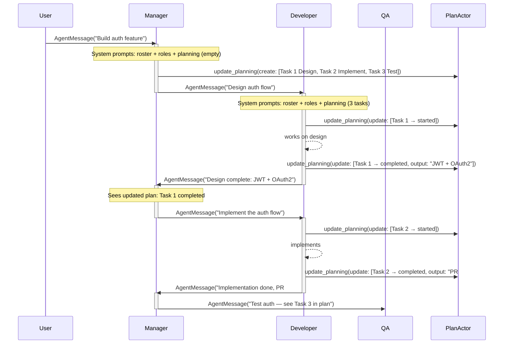
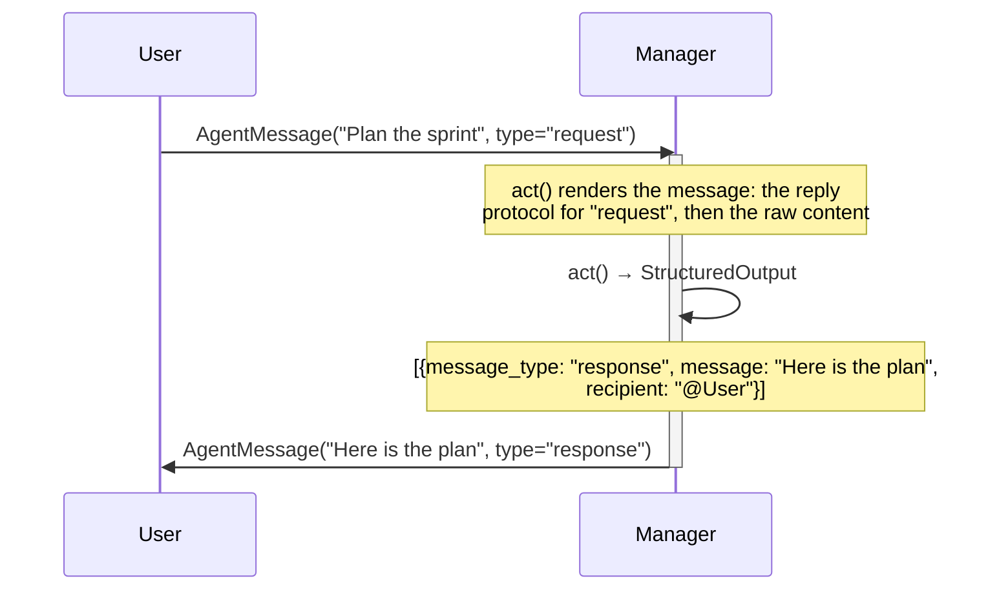
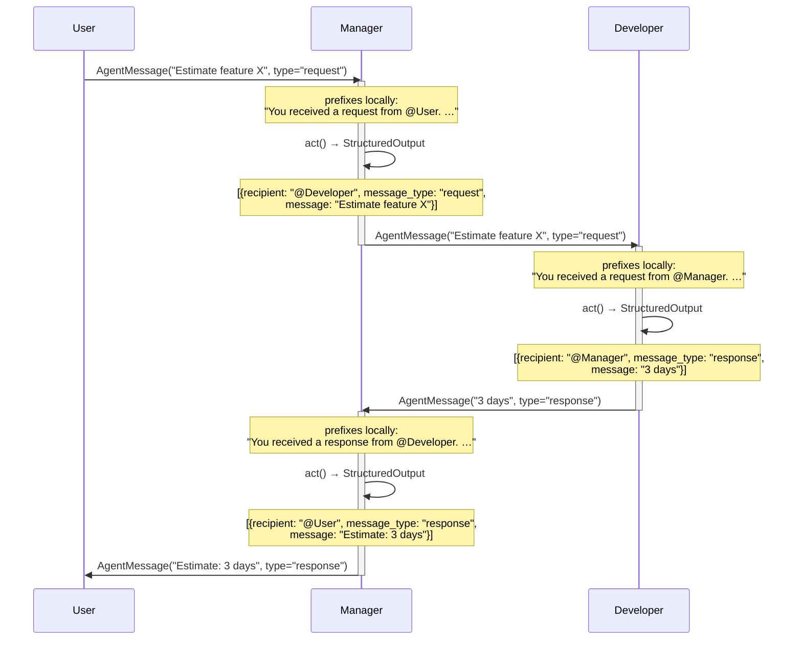
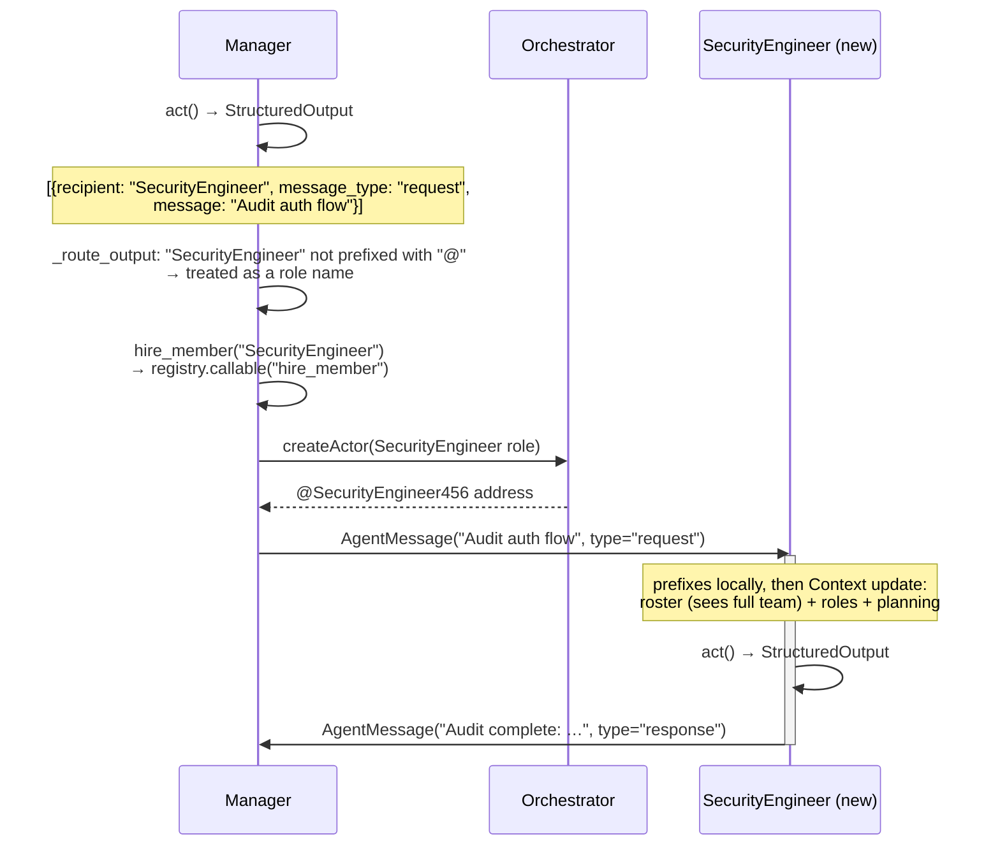
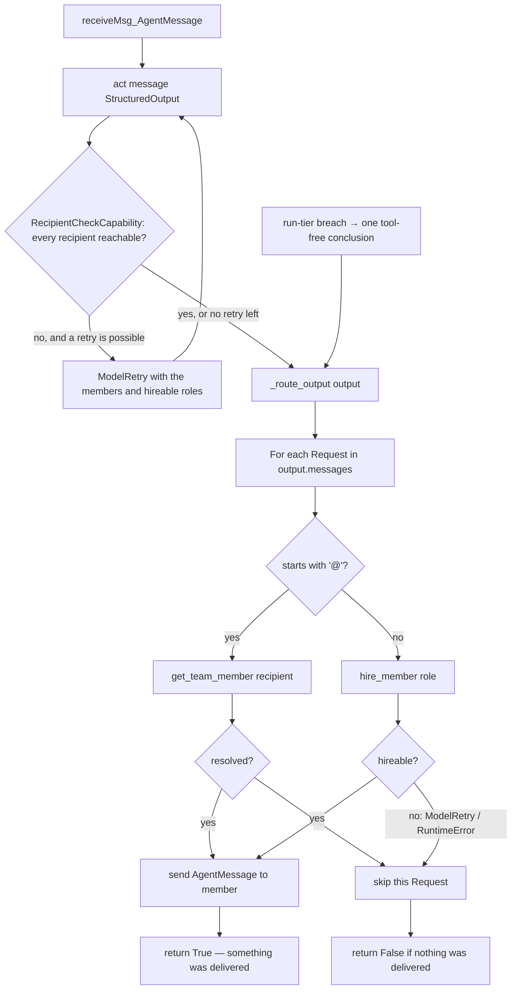

# Agent Collaboration: LLM-Driven Multi-Agent Communication

## Table of Contents

- [Business Need](#business-need)
- [Core Concept](#core-concept)
- [Architecture Overview](#architecture-overview)
- [Collaboration Tools: TeamTool and PlanningTool](#collaboration-tools-teamtool-and-planningtool)
- [Flow Diagrams](#flow-diagrams)
- [Key Implementation](#key-implementation)
- [Usage Examples](#usage-examples)
- [Best Practices](#best-practices)
- [Routing Patterns: Continuation vs. LLM-Driven](#routing-patterns-continuation-vs-llm-driven)
- [API Reference](#api-reference)
- [Testing](#testing)
- [Related Documentation](#related-documentation)
- [Contributing](#contributing)

---

## Business Need

### The Challenge: Simplifying Multi-Agent Routing

A multi-agent system has to decide **who owns routing**. One answer is a framework-managed
**continuation call stack**: the framework records the exact chain of requests and routes every
answer back through it automatically. That guarantees delivery, but the complexity lands on the
developer — reasoning about message flow means reasoning about the framework's bookkeeping.

`akgentic-agent` takes the other answer: routing is the **LLM's** job. The framework stays
minimal, and the agent produces explicit, directed messages.

**What LLM-driven routing buys:**

- ✅ A single `AgentMessage` type — no request/answer message pair to model
- ✅ The LLM reasons about routing, over a conversation history it can actually see
- ✅ Hire-by-role: the LLM addresses a _role_ and the framework hires on demand, for the roles
  whose card is marked `can_be_hired`
- ✅ No hidden call stack — the agent sees the dialogue, not framework state
- ✅ An unreachable recipient is sent back to the model while the run can still fix it, and
  skipped at routing time when it cannot — never a failed run

**What it costs:** nothing *forces* the LLM to reply to the right party. See
[Routing Patterns](#routing-patterns-continuation-vs-llm-driven) for when that matters.

### Real-World Scenarios

#### Scenario 1: Feature Estimation

```
User: "Estimate the effort for dark-mode support."
  ↓
Manager: LLM decides → sends AgentMessage to "FrontendDeveloper" (role)
  → Framework hires a FrontendDeveloper actor automatically (its card is can_be_hired)
  ↓
FrontendDeveloper: LLM decides → sends AgentMessage back to "@Manager"
  ↓
Manager: LLM decides → sends AgentMessage back to "@User"
```

The LLM at each step decides the recipient explicitly. No hidden call stack.

#### Scenario 2: Parallel Information Gathering

```
Manager receives: "What is the status of auth and payments?"
  ↓
Manager LLM output: StructuredOutput([
    {message: "Status of auth?",     recipient: "@AuthDev"},
    {message: "Status of payments?", recipient: "@PaymentsDev"},
])
  → Framework delivers both messages concurrently
  ↓
Both agents reply to "@Manager" when done
  ↓
Manager consolidates answers and replies to the original sender
```

The LLM expresses fan-out delegation in a single output. A continuation call stack would need
one request per collaborator, sequenced by hand.

---

## Core Concept

### The LLM as Router

Each agent invocation produces a `StructuredOutput` — a list of zero or more
`Request` objects:

```python
class Request(BaseModel):
    message_type: Literal[   # REQUIRED, and declared first — the sender's intent
        "request", "response", "notification", "instruction", "acknowledgment"
    ]
    message: str             # What to say
    recipient: str           # Who to say it to
```

All three fields are required: constructing a `Request` without `message_type` raises a
Pydantic `ValidationError`.

The `recipient` field drives all routing logic in `_route_output()`:

| Recipient format | Meaning                      | Framework action                                   |
| ---------------- | ---------------------------- | -------------------------------------------------- |
| `@MemberName`    | Existing team member by name | Direct send                                        |
| `RoleName`       | Role to hire                 | Auto-hire then send — only if the role is hireable |

`Request.recipient` is a plain string: there is no per-call `Request` subclass and no `enum`
constraint on `recipient` (Story 5.5), so the schema never varies from turn to turn. Validity is
checked in two places instead:

1. **Inside the run** — `RecipientCheckCapability` checks every recipient of the validated
   output against `team_directory()` and sends the output back with `ModelRetry` while one is
   unreachable. See [The recipient check](#the-recipient-check-telling-the-model-while-it-can-still-answer).
2. **At routing time** — `_route_output()` resolves each recipient through
   `resolve_recipient()` (`@name` → `get_team_member`, role → `hire_member`) and skips, with a
   log line, whatever the run could not correct.

### Who an agent can contact

| Question | Answer | Where |
|---|---|---|
| How does the agent know who is on the team? | `TeamTool`'s roster, in the per-turn **Context update** | `GetTeamRoster` |
| How does it know which roles it could hire? | `TeamTool`'s role list, each role marked `[hireable]` or `[not hireable]` | `GetRoleProfiles` |
| Which `@name`s are reachable? | Every current member except tool actors (`#`-prefixed) | `team_directory().members` |
| Which roles can be hired? | Roles whose `AgentCard.can_be_hired` is `True` (default **`False`**) — and only if the agent has the `hire_member` command | `team_directory().hireable_roles`, `can_hire` |
| Can it be restricted to talking to some members only? | **No.** Any member may address any other member. There is no allow-list and no `routes_to`; a topology lives in the prompts | — |
| Is `message_type` enforced? | **No.** It tells the receiver whether a reply is expected; nothing checks that a `response` answers a `request`, or that a `request` is answered | `REPLY_PROTOCOLS` |

To disable hiring for one agent, give it `TeamTool(hire_team_members=False)`. That removes both the
`hire_members` tool **and** the `hire_member` command, so routing cannot hire either, and the
recipient check tells the model "you cannot hire in this team" rather than offering it roles.

To steer a contact topology, override `team_directory()` in a subclass and narrow `members` (and
`hireable_roles`): the recipient check then refuses everyone else, and its correction lists only
the members you allowed. That is guidance, not enforcement — when the check stands down (retries
or request budget spent), `_route_output()` still delivers to any member `get_team_member()`
finds. A hard rule needs the same filter in the router.

### Context is the "Call Stack"

Where a continuation call stack keeps framework state tracking who asked whom,
`akgentic-agent` relies on `ReactAgent`'s `ContextManager`. Every message an agent
sends or receives is appended to its LLM conversation history. When the agent is
invoked again (after a collaborator replies), the full dialogue is available in context.

The LLM itself observes the conversation graph and decides what to do next — no hidden
index pointer, no framework-managed stack.

---

## Architecture Overview

### Component Hierarchy

```
┌─────────────────────────────────────────────────────────────────────┐
│                    Message (akgentic-core)                          │
│                    Base message for all types                       │
└─────────────────────────────┬───────────────────────────────────────┘
                              │
                   ┌──────────▼──────────┐
                   │    AgentMessage     │
                   │  type: Literal[5]   │
                   │       = "request"   │
                   │  content: str       │
                   │  (+ Message fields: │
                   │   id, parent_id,    │
                   │   team_id, sender,  │
                   │   recipient, …)     │
                   └──────────┬──────────┘
                              │
              ┌───────────────┴─────────────────┐
              │                                 │
   ┌──────────▼──────────┐          ┌───────────▼──────────┐
   │  receiveMsg_        │          │  process_human_input │
   │  AgentMessage()     │          │  (HumanProxy)        │
   │  (BaseAgent)        │          └──────────────────────┘
   └──────────┬──────────┘
              │
   ┌────────────────────────────┐
   │  receiveMsg_AgentMessage() │  ← no decorator; just the work
   └──────────┬─────────────────┘
              │
   ┌──────────▼──────────┐
   │  act()              │  ← @guard_usage_limits()
   │                     │    ReactAgent.run_sync(StructuredOutput)
   └──────────┬──────────┘
              │
   ┌──────────▼──────────────────────────────────────────────────┐
   │  StructuredOutput                                           │
   │  messages: list[Request({message_type, message, recipient})]│
   └──────────┬──────────────────────────────────────────────────┘
              │
              │  (inside the run: RecipientCheckCapability
              │   sends unreachable recipients back with ModelRetry)
   ┌──────────▼──────────┐
   │  _route_output()    │  ← Core routing engine; returns "delivered?"
   └──────────┬──────────┘
              │
     For each Request:
     ┌──────────────────────────────────────────────────────────┐
     │ recipient starts with "@"? → direct send to member        │
     │ recipient is a role name?  → hire (if hireable) + send    │
     │ unresolved / not hireable? → log and skip this Request    │
     └──────────────────────────────────────────────────────────┘
```

### Data Model

```python
class AgentMessage(MailboxMessage):  # akgentic.tool.mailbox; MailboxMessage extends Message
    """Single message type for all inter-agent communication."""
    type: Literal[
        "request", "response", "notification", "instruction", "acknowledgment"
    ] = "request"          # the sender's intent, defaulting to "request"
    content: str           # message body

class Request(BaseModel):
    """One entry in the LLM's StructuredOutput. Every field is required."""
    message_type: Literal[
        "request", "response", "notification", "instruction", "acknowledgment"
    ]
    message: str    # Raw message text
    recipient: str  # "@MemberName" or "RoleName"

class StructuredOutput(MergeableOutput):  # akgentic.llm
    """Complete LLM response: zero or more directed messages."""
    messages: list[Request] = []
```

`AgentMessage` adds exactly two fields of its own — `type` and `content` — and overrides the two
rendering methods `MailboxMessage` requires: `rendering()` (the prompt) and `rendering_preview()`
(one summary line for the mailbox). Everything else (`id`, `parent_id`, `team_id`, `timestamp`,
`sender`, `recipient`, `display_type`) is inherited from `akgentic-core`'s `Message`.

`StructuredOutput` subclasses `MergeableOutput` so that an output the model wrote as several JSON
objects is merged rather than rejected — see
[An output written twice](#an-output-written-twice-or-one-that-cannot-be-read).

The two `type` fields are the same protocol seen from both ends: `_route_output()` copies
`request.message_type` straight onto the `AgentMessage.type` it sends, so the receiver reads the
sender's intent as first-class data. It also fills the inherited `recipient` with the resolved
`ActorAddress` — the string→address resolution happens in `_route_output()`, and the delivered
message records its outcome.

### ToolFactory & 4-Channel Architecture

Every `BaseAgent` composes a `ToolFactory` that aggregates `ToolCard` instances into
four channels. Each `ToolCard` capability declares which channels it is exposed
through via `expose: set[Channels]`:

| Channel         | Method on `ToolCard`     | Purpose |
| --------------- | ------------------------ | ------- |
| `TOOL_CALL`     | `get_tools()`            | LLM-callable functions (`hire_members`, `fire_members`, `update_planning`) |
| `SYSTEM_PROMPT` | `get_system_prompts()`   | Static prompts rendered once into the frozen system block. Nothing on the default card set uses it |
| `LLM_CONTEXT`   | `get_context_states()`   | Volatile team state — roster, role list, planning board — composed by the `ContextUpdater` into at most one **Context update** block per turn: a full snapshot first, then only what changed |
| `COMMAND`       | `get_commands()`         | Folded by `ToolFactory.get_command_registry()` into one name-keyed `CommandRegistry`, reached from in-agent code and `/`-prefixed messages (`hire_member`, `planning_summary`) |

The team-state capabilities normalise `SYSTEM_PROMPT` to `LLM_CONTEXT`: a card that still asks for
`SYSTEM_PROMPT` on the roster, the role list or the planning board gets `LLM_CONTEXT`.

`ToolCard.get_commands()` is how a tool declares its COMMAND-channel callables.
`BaseAgent.on_start()` collects them through `ToolFactory.get_command_registry()`, which keys every
command by the callable's `__name__` and derives an argument schema from its signature. See
[The Command Registry](#4-the-command-registry) for the two surfaces that reach it.

Two `ToolCard` implementations are central to collaboration — **TeamTool** and
**PlanningTool** — described in the next section.

---

## Collaboration Tools: TeamTool and PlanningTool

Two tools are the pillars of multi-agent collaboration. Both are **`ToolCard`
subclasses** resolved by `ToolFactory` into the four channels above.

### TeamTool — Team Awareness and Composition

`TeamTool` is **automatically injected** by `BaseAgent.on_start()` unless
already present in `config.tools`. It enables the LLM to see who is on the team,
what roles are available, and to hire or fire members.

| Capability            | Default channels           | Description                                                                    |
| --------------------- | -------------------------- | ------------------------------------------------------------------------------ |
| **`GetTeamRoster`**   | `LLM_CONTEXT`, `COMMAND`   | The live list of team members and their roles (command: `/team_members`)       |
| **`GetRoleProfiles`** | `LLM_CONTEXT`, `COMMAND`   | Every role of the agent catalog — description, skills, hireable or not (command: `/team_roles`) |
| **`HireTeamMember`**  | `TOOL_CALL`, `COMMAND`     | LLM-callable tool to hire new members by role (command: `/hire_member`)        |
| **`FireTeamMember`**  | `TOOL_CALL`, `COMMAND`     | LLM-callable tool to remove members by name (command: `/fire_member`)          |
| **`GetTeamActivity`** | opt-in (`False` by default) | `team_activity` report: who is mid-handler, and on what                       |

**Why it matters for collaboration**: the two `LLM_CONTEXT` capabilities (`GetTeamRoster` and
`GetRoleProfiles`) give the LLM the information it needs to make routing decisions. On the
agent's first turn the Context update carries both in full:

```
**Here is the team member list by name (and role):**
@Manager (role: Manager) - [you]
@Developer456 (role: Developer)
@QA789 (role: QA)

**Here is the team role list:**
Manager: Helpful manager coordinating team work (Skills: coordination, delegation) [not hireable]
Developer: Full-stack developer (Skills: coding, architecture) [hireable]
QA: Quality assurance engineer (Skills: testing, automation) [hireable]
```

On later turns only the changes are sent — `@SecurityEngineer457 (role: SecurityEngineer) joined
the team.`, `Role re-described — …` — and nothing at all when nothing changed. The baselines live
on `AgentState.tool_state`, so a restored agent resumes delta delivery instead of re-snapshotting.

Actors whose name starts with `#` (tool actors) are excluded from the roster, and the agent
reading it is marked `- [you]`. The `[hireable]` marker mirrors `AgentCard.can_be_hired`, which
defaults to `False`: a role nobody marked hireable is listed but cannot be hired. When no role is
hireable the list closes with `No role in this list can be hired.`

That is the whole mechanism. **Nothing is injected into the output schema** — `act()` reasons
against the static `StructuredOutput` type — so the developer never hard-codes team structure
into a prompt, and the schema never varies from call to call. Turning either capability off
(`TeamTool(get_team_roster=False)`) leaves the agent blind to it; the recipient check then becomes
the only place it learns who exists.

### PlanningTool — Coordinating Complex Multi-Agent Work

`PlanningTool` is the key mechanism for **complex, multi-step collaborations**. When
multiple agents must work in sequence or in parallel toward a shared goal, the
planning tool provides a shared, persistent task board backed by a `PlanActor`.

| Capability            | Default channels           | Description                                          |
| --------------------- | -------------------------- | ---------------------------------------------------- |
| **`GetPlanning`**     | `LLM_CONTEXT`, `COMMAND`   | The task board, in the per-turn Context update (command: `/planning_summary`) |
| **`GetPlanningTask`** | `TOOL_CALL`, `COMMAND`     | LLM-callable tool to retrieve a single task by ID    |
| **`UpdatePlanning`**  | `TOOL_CALL`                | LLM-callable tool to create, update, or delete tasks |
| **`SearchPlanning`**  | `TOOL_CALL`, `COMMAND`     | Search tasks by status, owner, creator, or description |

The LLM sees the plan in its Context update: in full on the first turn, then only the tasks that
changed. `GetPlanning.filter_by_agent` defaults
to **`True`**, so out of the box each agent sees only the tasks it owns or created, under a
`**Your tasks** (owner or creator: @Manager):` header — and
`No tasks assigned to or created by @Manager yet.` when it has none. Pass
`GetPlanning(filter_by_agent=False)` to show the whole board instead:

```
**Team planning:** 3 tasks total
Owners: @Developer456: 1 | @Manager: 1 | @QA789: 1

**All tasks:**
- ID 1 [started] Design auth flow (Owner: @Developer456, Creator: @Manager)
- ID 2 [pending] Write integration tests (Owner: @QA789, Creator: @Manager)
- ID 3 [completed] Review security requirements — Output: OWASP checklist applied (Owner: @Manager, Creator: @Manager)

Use get_planning_task(id) for exact ID lookup or search_planning(...) to filter tasks.
```

The totals line and the owner breakdown are the same either way; only the task list narrows. The
` — Output: …` segment appears only when a task actually has an output.

#### Custom Instructions via `UpdatePlanning`

`UpdatePlanning` accepts an `instructions` parameter that is appended to the tool's
docstring. This lets you inject domain-specific rules that the LLM follows when
updating the plan:

```python
from akgentic.tool.planning import PlanningTool, UpdatePlanning

planning_tool = PlanningTool(
    update_planning=UpdatePlanning(
        instructions="""CRITICAL: Always keep the plan updated.
Create tasks when your task involves other team members
or is complex enough to require multiple steps.
Update task status when you make progress.
Record outputs when you complete work.
Do not finish your turn if the plan is stale."""
    )
)
```

This produces a tool docstring the LLM sees as:

```
Update team tasks (create, update, delete).

Field constraints (violating them causes a validation error):
- description: max 300 characters — keep it concise.
- output: max 150 characters — will be truncated automatically if exceeded.

Additional Instructions:
CRITICAL: Always keep the plan updated.
Create tasks when your task involves other team members
or is complex enough to require multiple steps.
...
```

`format_docstring()` appends `"\n\nAdditional Instructions:\n"` plus the text; with no
`instructions` set, the original docstring is returned untouched.

#### How TeamTool + PlanningTool Work Together



The planning tool acts as shared memory. Each agent sees the same task list (via
`LLM_CONTEXT`), updates it (via `TOOL_CALL`), and other agents observe those
changes on their next invocation.

---

## Flow Diagrams

### 1. Single-Agent Reply



Every arrow above carries the **raw** `request.message`. The `"You received a … from …"` line is
never on the wire — each receiver builds its own from the `type` it was handed.

### 2. Two-Hop Delegation (Known Member)



The prefix is built by the **receiver**, from the `type` on the message it just received — it is
not part of the payload the sender transmits.

### 3. Hire-by-Role Delegation

When the LLM addresses a recipient that is a role name (no `@` prefix), the
framework hires a new actor of that role before delivering the message.



### 4. _route_output() Decision Tree

The routing loop is `_route_output()`'s body, and it has exactly one caller:
`receiveMsg_AgentMessage()`. The tool-free conclusion of a turn cut short by a run-tier usage
limit needs no second path — `akgentic-llm` returns it through `act()` as an ordinary
`StructuredOutput`, so it arrives at the requester like any other message.



> **Note:** By the time `_route_output()` runs, the recipient check has already sent every
> unreachable recipient back to the model once a retry was possible. What reaches routing
> unresolved is what the run could not correct: an unknown `@member`, or a role that cannot be
> hired, is logged and not delivered to. The routing logic is a simple two-branch dispatch.
>
> `_route_output()` returns whether anything actually went out. **No caller reads that bool
> today** — the usage-limit guard that used to was retired, which is the
> [known gap](#5-usage-limit-protection) below.

### 5. Mailbox Visibility

An agent sees its pending mail through two live surfaces (the former `mailbox_notifications`
start-up system prompt is gone — the system block is frozen and carries no mailbox content).
Mailbox awareness reaches the model through the mid-run arrival notice alone: `MailboxTool`
serves no `LLM_CONTEXT`, a second card-side carrier having only narrated the same arrivals
twice.

- **`read_mailbox` tool** (`TOOL_CALL` channel, provided by `MailboxTool`, auto-added beside
  `TeamTool`) — it names **one** message, by the id the arrival notice gave it. The tool reads
  nothing and returns nothing but an acknowledgement; `MailboxCapability.after_tool_execute` is
  what makes that acknowledgement true, consuming exactly the named message and injecting its
  own `rendering()` as a turn of its own. So naming an id **absorbs that one message**: it
  is not delivered again, and the model must deal with it in this run. Mail left unnamed stays
  queued and arrives as its own turn once the run ends. An absent or unknown id is a silent
  no-op. A pending `/stop` or `CancelMessage` is never offered an id and never absorbed by a
  read — the cancellation surface is left intact for the hook below.
- **The mid-run arrival notice** — mail arriving *while a run is in progress* is announced
  once by `MailboxCapability.before_model_request`, through
  `ctx.enqueue(notice, priority="asap")`. pydantic-ai's auto-injected drain capability
  delivers the notice into the model request at the next step boundary and records it in the
  durable history and the event store as its own user-role message — the transcript records
  the ring, and that record is the audit trail. A notice enqueued at the run's last boundary
  is not lost: the drain redirects through one final model request to deliver it. Every
  announced message is listed, but only a message this run can take on carries an `(id: …)`
  beside its preview; everything else is listed as `- Message cannot be handled in the run`,
  with no id. That missing id *is* the constraint — such a message is visible but unaskable,
  not rejected and not refused. The closing line matches: it points at `read_mailbox` only when
  at least one id is on offer. See the README's *The mid-run arrival notice* for the four
  conditions that decide it.

The same hook enforces run cancellation: a pending `/stop` or `CancelMessage` is purged from
the mailbox and then raises `RunInterruptedError` at the next step boundary, caught in `act()`
— which notifies the human and returns a default output the router delivers as nothing, so no
handler carries a catch.
The run dies, the agent survives. The hook and the vocabulary it applies (`is_cancel`,
`render_arrival_notice`) live in `akgentic.tool.mailbox.capability`, beside the capability,
not on the card. `BaseAgent` builds the capability unconditionally so an agent configured *without*
`MailboxTool` is still interruptible, and such an agent has no card to borrow a predicate
from. The card keeps its own surface: the id-taking `read_mailbox` tool and the `/stop`
registration whose string form `is_cancel` recognises without importing anything from
the card. See the README's *Run Cancellation* section for the full flow and its stated
limitations.

---

## Key Implementation

### 1. Message Delivery (act → _route_output)

```python
def _route_output(self, output: StructuredOutput) -> bool:
    delivered = False

    for request in output.messages:
        member = resolve_recipient(self, request.recipient)

        if member is not None:
            self.send(
                member,
                AgentMessage(
                    content=request.message,
                    type=request.message_type,
                    recipient=member,
                ),
            )
            delivered = True

    return delivered
```

The `@member`-versus-role decision itself lives in `resolve_recipient()` (`utils.py`), not
here — it is the *team's* addressing convention rather than this output schema's, so every
agent class routing an LLM-chosen recipient needs exactly it:

```python
def resolve_recipient(agent: TeamResolver, recipient: str) -> ActorAddress | None:
    if recipient.startswith("@"):
        return agent.get_team_member(recipient)
    try:
        return agent.hire_member(recipient)
    except (ModelRetry, RuntimeError) as error:
        logger.warning("No member answers to %r and it cannot be hired (%s); ...", recipient, error)
        return None
```

The sender delivers the **raw** `request.message`; the reply-protocol prefix is added by
the *receiving* agent's `receiveMsg_AgentMessage()` (see below), keyed to the intent that
agent received. The recipient check has already had its chance inside the run, so the dispatch
is a simple two-branch lookup, and a recipient it still cannot resolve is skipped rather than
raised.

`_route_output()` is the class's single routed send path, and it **returns whether anything
was actually delivered**. `receiveMsg_AgentMessage()` calls it for a normal turn, and the
tool-free conclusion of a turn cut short by a run-tier usage limit
(see [Usage Limit Protection](#5-usage-limit-protection)) goes through the very same helper —
so a concluded answer is delivered exactly like any other message. Nothing reads the bool today,
so an answer that reached nobody is not reported — see the known gap there.

### 2. Static Structured Output + Prompt-Carried Reply Protocol

`act()` forwards the `output_type` it was handed to the REACT loop — no per-call subclass
and no `type()` metaprogramming on the hot path:

```python
output = self._react_agent.run_sync(prompt, deps=self, output_type=output_type)
```

`receiveMsg_AgentMessage()` passes `StructuredOutput`, so the delegation path above reasons
against the **static** schema. It is also the type `akgentic-llm` reuses when it concludes a
turn cut short by a run-tier breach, so that turn reasons against the same schema by
construction — the caller declares it once, for both.

The reply-protocol guidance is carried in the **prompt**, not the output schema. The handler
composes none of it: it hands the message over, and the message frames itself when `act()`
renders it:

```python
# In receiveMsg_AgentMessage():
output = self.act(message, StructuredOutput)

self._route_output(output)


# In AgentMessage.rendering(), which act() calls once:
sender_name = self.sender.name if self.sender else "unknown"
article = "an" if self.type[0] in "aeiou" else "a"
return (
    f"You received {article} {self.type} from {sender_name}. "
    f"{REPLY_PROTOCOLS.get(self.type, '').format(sender=sender_name)}"
    f"\n\n{self.content}"
)
```

`"unknown"` in the renderer is prose for the prompt only, never an address: a placeholder echoed
back as a `Request.recipient` would have no leading `@`, and a recipient without one is a role to
**hire**. The recipient check refuses it (no such hireable role), and routing skips it.

This supersedes the schema-constrained-recipient + docstring-injection mechanism from
Story 5.1 / ADR-004; the intent-driven 5-type protocol itself is unchanged.

### 3. Hire-by-Role (hire_member)

When the LLM names a role instead of a `@member`, `resolve_recipient` calls `hire_member(role)`,
which resolves `TeamTool`'s `hire_member` command from the registry's **typed** surface and
invokes it with the native argument — no `/hire …` string round-trip, and the native
`ActorAddress` comes straight back:

```python
def hire_member(self, role: str) -> ActorAddress:
    if not self._command_registry.has("hire_member"):
        raise RuntimeError("hire_member command not available — TeamTool not configured")

    hire = self._command_registry.callable("hire_member")
    return cast(ActorAddress, hire(role))
```

Internally, `TeamTool` asks the `Orchestrator` to create a new actor of the
requested role and register it in the team roster. The address is returned and
the message is immediately delivered to the newly hired actor.

If the role does not exist in the agent catalog, or its card is not marked `can_be_hired`, the
command raises a `RetriableError`, which `ToolFactory` has wrapped into `ModelRetry`. When the
model calls the `hire_members` **tool** mid-reasoning, that retry is honoured and the LLM gets
to try a different role. On the **routing** path it cannot be: `_route_output()` runs after
`act()` has returned, so the run is already over. `resolve_recipient()` therefore catches the
`ModelRetry` — and the `RuntimeError` of a card that does not expose `hire_member` as a command
— logs it, and skips that one delivery, so the turn's other messages still go out.

#### The recipient check: telling the model while it can still answer

Skipping keeps the turn alive but loses the message, and the model never learns why. So
every `BaseAgent` also validates recipients **inside** the run, before anything is routed.
`RecipientCheckCapability` (`akgentic.agent.recipients`) hooks pydantic-ai's
`after_output_validate`. It asks `team_directory()` — the members, and the roles of the
orchestrator's agent catalog whose cards are `can_be_hired`, read through one
`discover_catalog()` proxy call — about every recipient of the validated `StructuredOutput`,
and while one is unreachable it raises `ModelRetry`. The prompt gives one line per recipient
saying why it failed, then one instruction that depends on whether this agent can hire at all.
For a coordinator that cannot hire:

```
Nothing was sent.
- 'Expert' has no '@', so it was read as a role to hire, and you cannot hire in this team.
- No team member is called '@Researcher'.
Address every message to a current member by exact @name: @Expert, @Human.
```

and for one that can hire, but not that role:

```
Nothing was sent.
- 'Expert' has no '@', so it was read as a role to hire, and it is not a role you can hire.
Address a member by exact @name: @Expert, @Human — or write one of these roles without '@' to hire it: Developer.
```

An agent that cannot hire is never invited to try another role. The model rewrites its answer in
the same run. A correct answer costs nothing.

The check **stands down** when a retry could not be honoured, and routing then skips what is
still unreachable:

| When | Why raising would be worse |
|---|---|
| the output retries are spent | the run ends in `UnexpectedModelBehavior` and every message is lost |
| the run's request limit is reached — always so in akgentic-llm's tool-free conclusion | the run ends in a usage-limit error |
| the output is partial (streaming) | the answer is not finished yet |

It reads `StructuredOutput` only. An agent routing a shape of its own returns a second
`RecipientCheckCapability(recipients=...)` from `extra_capabilities()`, with an extractor that
reads its recipients — see `CustomAgent`.

#### An output written twice, or one that cannot be read

The step before — turning the model's text into a `StructuredOutput` at all — is guarded by
akgentic-llm's `MergeableOutputCapability`, which every `ReactAgent` mounts and which
`StructuredOutput` opts into by subclassing `MergeableOutput`. Its contract is **one** JSON
object holding **one** `"messages"` array, and models break it in a way that is easy to miss.
OpenAI's Responses API may send a `commentary` text part ahead of the `final_answer`, each a
valid object; pydantic-ai joins the parts, and two valid objects become one string that does not
parse.

- **Merged before validation.** When the text is two or more JSON objects back to back, each a
  valid `StructuredOutput`, they are merged through `StructuredOutput.merge`, messages in the
  order written. Every message the model meant to send is delivered, and no retry is spent.
  A message repeated across the objects — same `message_type`, `message` and `recipient` — is
  sent once, where it first appears.
  Anything else — trailing prose, a truncated object, an object that does not validate — is left
  to validation.
- **"Nothing was sent" when it still fails.** pydantic-ai's own retry names only the parse error.
  A model reads that as a format fix, keeps the messages it believes already went out, and
  resends only the rest — then tells the human it asked someone it never asked.
  The capability asks the schema for its retry instead, and
  `StructuredOutput.unreadable_output_error` says:

```
Nothing was sent: your reply could not be read, so none of its messages reached anyone.
- Invalid JSON: trailing characters at line 1 column 216
Resend every message of this turn as items of ONE "messages" array, in exactly ONE JSON object.
```

An output type that is not a `MergeableOutput` keeps pydantic-ai's retry unchanged; one that is
but does not override `unreadable_output_error` gets akgentic-llm's generic wording.

### 4. The Command Registry

`on_start()` folds every `COMMAND`-channel capability of the agent's tool cards into a single
`CommandRegistry`, adds `compact` and `clear` as command-only built-ins, and announces the whole
set exactly once so services can discover it without per-command coupling:

```python
self._command_registry = tool_factory.get_command_registry(
    extra_commands=[self.compact, self.clear]
)
self.notify_event(
    CommandsAnnouncedEvent(
        agent=self.myAddress,
        commands=self._command_registry.descriptors(),
    )
)
```

Commands are keyed by the callable's `__name__`. The canonical names are therefore
`hire_member`, `fire_member`, `team_members`, `team_roles`, `planning_summary`,
`get_planning_task`, `search_planning`, `compact`, `clear` — the exact set depends on which tool
cards the agent carries. Two surfaces reach that one table:

| Surface | Call | Returns | Used by |
|---|---|---|---|
| **typed / in-agent** | `registry.callable("hire_member")(role)` | native value (`ActorAddress` here) | `hire_member()`, `act()`'s media expansion |
| **human / text** | `registry.dispatch("/hire_member Developer")` | `str` | `/`-prefixed messages from a human |

`registry.has(name)` tests availability; `registry.descriptors()` returns serializable discovery
metadata (name, description, argument schema, owning tool card).

#### Slash dispatch

`receiveMsg_AgentMessage()` inspects the **raw** content before any prefixing. A leading `/`
routes the message to `_dispatch_command()`, which never reaches the LLM path:

```python
if message.content.startswith("/") and self._dispatch_command(message, sender):
    return
```

`_dispatch_command()` dispatches the text, sends the result back to the sender as a
`notification` `AgentMessage` — a non-`request` type, so it does not start a reply loop — and
records one synthetic, human-attributed **operator action** in the LLM context, so the agent
reasons about what the human did without mistaking it for its own tool call.

The fallback is what makes this safe to put in front of every message:

- **Unknown leading token** → `dispatch` raises `CommandNotRecognized`; `_dispatch_command()`
  swallows it and returns `False`, so the message continues down the normal LLM path with its
  original content. **No operator action is recorded** — the command never ran.
- **Known command, bad arguments** (or the body raising) → caught *inside* `dispatch`, returned
  as a result string. Handled exactly like a success; never falls back to the LLM.
- **A `None` result** → *handled, say nothing*. `_dispatch_command()` returns `True` at once:
  no `notification` back to the sender and **no operator action recorded**. That is the
  outcome for a command whose whole effect happens elsewhere, which an empty reply and a
  second context entry would only double-report.

```python
# From the human side — see examples/simple_team.py
human_addr.send(manager_addr, AgentMessage(content="/team_members"))
human_addr.send(manager_addr, AgentMessage(content="/hire_member DevOpsEngineer"))
```

### 5. Usage Limit Protection

**The policy no longer branches on the tier — and this package no longer degrades anything.**
Both are `akgentic-llm`'s: `LimitRecoveryCapability` decides whether a breached turn concludes,
drives the conclusion through the `output_type` the caller already asked for, and re-raises the
**ORIGINAL** breach when it declines or fails.

So an error that arrives here has already exhausted its options, and there is exactly one
response left:

```python
try:
    return method(self, *args, **kwargs)
except LLMUsageLimitError as e:
    escalate_usage_limit(self, e)
```

**The `except` is on the base, deliberately.** `RunUsageLimitError` and `AgentUsageLimitError`
both subclass it (`LLMUsageLimitError` is that module's alias for `akgentic.llm.UsageLimitError`)
and both take this path. The per-tier ladder that used to live here was correct on the day it
was written and silently incomplete afterwards: it only worked while its clauses stayed ordered
most-specific-first, and a wrong copy compiled, passed an ordinary test, and stopped concluding.

**It is a decorator on `act()`, not on the handler.** `receiveMsg_AgentMessage` carries no
`try`/`except` of its own at all, and no decorator either:

```python
class BaseAgent(Akgent[AgentConfig, AgentState]):
    @guard_usage_limits()
    def act(self, message: LlmRenderable, output_type: type[T]) -> T:
        ...
```

That placement is what makes the policy unskippable. On a handler it was a caller obligation —
invisible from `usage_limits.py`, and silently dropped by the one handler that forgot it. On
`act()` it arrives with the LLM call, because *making the call* is what triggers it. It also
puts the two ways a turn can end early in one place: `act()` already absorbs
`RunInterruptedError` and hands back a default output (see
[Mailbox Visibility](#5-mailbox-visibility)), and a usage breach is the other one. `compact()`
carries the guard too — it is the other path to the model, through the summarizer sub-run.

The decorator takes **no arguments and reads none**: no `output_type`, no `route`, no requester
lifted off a message. It preserves the guarded method's signature and hands its return value
straight back.

`escalate_usage_limit()` is the unchanged escalation: `notify_human()` to the team's first
user-proxy member — found structurally through `ActorAddress.is_user_proxy`, so any role string
works; when the team has none, the notice is logged and dropped — then
`raise WarningError(f"LLM usage limit exceeded: {error}")`. It reports the error it was handed,
which on a run-tier breach is the original one, never the secondary failure.

Neither `usage_limits.py` nor `utils.py` imports `agent.py`. That is deliberate: they are what a
*new* agent class needs, so a dependency in that direction would make them unusable from the
module that defines the base class. What each needs from an agent is stated structurally —
`AgentLike` and `TeamResolver` are `Protocol`s — never by naming a class.

There is deliberately **no retry and no counter**. `akgentic-llm` consumes agent-tier budget
before every call, the conclusion call included, so repeated run-tier breaches walk the agent
into its terminal tier by construction; a counter would only duplicate a bound that already
exists. That bound is only as real as the budget behind it: the default `AgentUsageLimits()` is
all-`None` and never blocks, so an agent left on the defaults breaches, concludes and breaches
again indefinitely — see ❌ DON'T #3.

An unreachable recipient in a conclusion is not sent back: the conclusion runs on a one-request
budget, so the recipient check stands down, `get_team_member()` returns `None` and delivery is
skipped rather than raising. That applies to a conclusion as much as to a
normal turn, which is why this document says the LLM **attempts** a conclusion — never that the
requester is guaranteed a reply.

**Known gap.** Two of those cases are now silent. A conclusion that resolves no recipient, or
that comes back with an empty `StructuredOutput.messages`, is an ordinary success: nothing
raises, nothing is sent, and no human is told. The retired helper caught both through
`_route_output()`'s bool. `akgentic-llm` cannot — it receives the output as `Any` — and the
guard never sees the output at all. Tracked as ADR-021 §Q2, and pinned by
`test_usage_limit_handling.py::TestARescuedTurnIsIndistinguishable::test_a_conclusion_that_routes_nothing_is_silent`.

### 6. Writing a second agent class

A subclass with its own structured output and its own `receiveMsg_*` **declares nothing** for
usage limits. The guard is on `BaseAgent.act`, so the subclass inherits it by calling `act()` —
which is the only way it can reach the LLM at all:

```python
from akgentic.agent.utils import resolve_recipient


class CustomAgent(BaseAgent):
    def _route_triage(self, output: TriageOutput) -> bool:
        """Act on a TriageOutput: log the assessment, deliver the handoffs.

        Called from the handler body — and that one call serves the normal turn, the
        interrupted one, and the turn akgentic-llm concluded after a breach.
        """
        delivered = False
        for handoff in output.handoffs:
            member = resolve_recipient(self, handoff.recipient)
            if member is None:
                continue
            self.send(
                member,
                AgentMessage(content=handoff.task, type="request", recipient=member),
            )
            delivered = True
        return delivered

    def receiveMsg_TriageMessage(self, message: TriageMessage, sender: ActorAddress) -> None:
        """Handle one incident. No try/except and no decorator: act() owns both."""
        output = self.act(message, TriageOutput)
        self._route_triage(output)
```

What the subclass gets, and what it must supply:

| | |
|---|---|
| **Reused unchanged** | `act(message, output_type)` — renders the message you hand it and forwards the type you name to the REACT loop, so a custom output model needs no plumbing; absorbs `RunInterruptedError` itself (notify the human once, return a default `output_type()`); and carries `@guard_usage_limits()`, so the usage-limit policy arrives with the call rather than being declared. `MailboxCapability` — built unconditionally, so every subclass gets all of its duties without asking: the run is interruptible, the recognised cancel is purged from the mailbox at recognition, and mid-run arrivals are announced to the model once; `notify_human`, `send`, `get_team_member`, `hire_member` — no schema in their signatures |
| **Supplied here** | the output model, the message type and its handler, and the router that delivers the output; optionally `extra_capabilities()`, returning pydantic-ai capabilities of your own — the framework prepends `MailboxCapability` and `RecipientCheckCapability`, so the list is always `[mailbox, recipient_check, *yours]` and the cancel check keeps running first |

A run-tier breach in `CustomAgent` still concludes in **`TriageOutput`** and is still delivered
by **`_route_triage`**, with `CustomAgent` overriding *and declaring* nothing — because
`akgentic-llm` reuses the `output_type` the handler already passed to `act()`, and the
conclusion comes back out through `act()` like an ordinary turn. `TriageMessage` subclasses
`Message` rather than `AgentMessage`, and dispatch walks the message class MRO looking for
`receiveMsg_<Type>`, so the handler is found with no registration step.

The runnable version is `src/akgentic/agent/custom_agent.py`.

---

## Usage Examples

### Example 1: Minimal Team with Planning

This is the typical setup for a collaborative team. Adapted from
[examples/simple_team.py](https://github.com/b12consulting/akgentic-agent/blob/master/examples/simple_team.py):

```python
from akgentic.agent import AgentConfig, AgentMessage, BaseAgent, HumanProxy
from akgentic.core import ActorSystem, AgentCard, BaseConfig, Orchestrator
from akgentic.llm import ModelConfig, PromptTemplate
from akgentic.tool.planning import PlanningTool, UpdatePlanning

# PlanningTool with custom instructions for the LLM
planning_tool = PlanningTool(
    update_planning=UpdatePlanning(
        instructions="""CRITICAL: Always keep the plan updated.
Create tasks when your task involves other team members
or is complex enough to require multiple steps.
Update task status when you make progress.
Record outputs when you complete work.
Do not finish your turn if the plan is stale."""
    )
)
tools = [planning_tool]  # add search_tool, knowledge_graph, etc. as needed

# TeamTool and MailboxTool are NOT listed here — both are auto-injected by BaseAgent

# `role` is NOT an AgentCard constructor keyword — AgentCard.role is a read-only
# property reading config.role. Passing role= here would be silently ignored.
manager_card = AgentCard(
    description="Helpful manager coordinating team work",
    skills=["coordination", "delegation"],
    agent_class="akgentic.agent.BaseAgent",
    config=AgentConfig(
        name="@Manager",
        role="Manager",
        prompt=PromptTemplate(
            template="You are a helpful manager. Coordinate the team effectively.",
        ),
        model_cfg=ModelConfig(provider="openai", model="gpt-4o", temperature=0.3),
        tools=tools,
    ),
    # can_be_hired stays False: the Manager is created below, not hired.
)

# ... define assistant_card, expert_card similarly, each with can_be_hired=True —
# a card that leaves it at its False default is listed as [not hireable], and a
# message addressed to that role is sent back to the model, then dropped.

actor_system = ActorSystem()
orchestrator_addr = actor_system.createActor(
    Orchestrator, config=BaseConfig(name="@Orchestrator", role="Orchestrator")
)
orchestrator_proxy = actor_system.proxy_ask(orchestrator_addr, Orchestrator)
orchestrator_proxy.register_agent_profiles([manager_card, assistant_card, expert_card])

human_addr = orchestrator_proxy.createActor(
    HumanProxy, config=BaseConfig(name="@Human", role="Human")
)
human_proxy = actor_system.proxy_tell(human_addr, HumanProxy)

manager_addr = orchestrator_proxy.createActor(
    BaseAgent, config=manager_card.get_config_copy()
)

human_proxy.send(manager_addr, AgentMessage(content="Build the auth feature."))
```

### Example 2: LLM Routing Decisions at Runtime

The following shows what happens inside a single `receiveMsg_AgentMessage()` turn,
not code you write — the LLM produces this output:

```python
# The LLM sees (via TeamTool's Context update):
#   Team members: @Manager [you], @Developer456, @QA789
#   Roles: Manager [not hireable], Developer, QA, SecurityEngineer [hireable]
#
# The LLM returns:
StructuredOutput(messages=[
    # Reply to the original sender
    Request(message_type="response", message="I'll coordinate...", recipient="@Human"),
    # Direct send to existing member
    Request(message_type="instruction", message="Implement OAuth", recipient="@Developer456"),
    # Hire a new role on demand
    Request(message_type="request", message="Audit auth flow", recipient="SecurityEngineer"),
])

# _route_output() resolves each:
# "@Human"             → starts with "@" → get_team_member → direct send
# "@Developer456"      → starts with "@" → get_team_member → direct send
# "SecurityEngineer"   → no "@" → hireable → hire_member → send to new actor
```

### Example 3: Waiting for a Collaborator

```python
# Agent cannot proceed until another agent replies.
# LLM returns:
StructuredOutput(messages=[])  # ← empty list

# The agent's turn ends. When @Developer456 replies later,
# receiveMsg_AgentMessage fires again with full context history.
# The LLM sees the previous conversation + the new message
# and continues from where it left off.
```

### Example 4: PlanningTool Driving Complex Collaboration

```python
# Manager's LLM call #1
# Sees: empty plan, team: [@Developer456, @QA789]
# LLM calls update_planning tool:
UpdatePlan(
    create_tasks=[
        TaskCreate(id=1, status="pending", description="Design auth flow", owner="@Developer456"),
        TaskCreate(id=2, status="pending", description="Implement auth", owner="@Developer456",
                   dependencies=[1]),
        TaskCreate(id=3, status="pending", description="Write auth tests", owner="@QA789",
                   dependencies=[2]),
    ]
)
# Then returns:
StructuredOutput(messages=[
    Request(message_type="instruction",
            message="Start with Task 1: design the auth flow",
            recipient="@Developer456"),
])

# Developer's LLM call
# Sees plan: Task 1 [pending], Task 2 [pending], Task 3 [pending]
# LLM calls update_planning:
UpdatePlan(update_tasks=[TaskUpdate(id=1, status="completed", output="JWT + OAuth2 design")])
# Then returns:
StructuredOutput(messages=[
    Request(message_type="response",
            message="Design complete — JWT + OAuth2. Ready for Task 2.",
            recipient="@Manager"),
])

# Manager's LLM call #2
# Sees updated plan: Task 1 [completed], Task 2 [pending], Task 3 [pending]
# Routes Task 2 to developer...
```

---

## Best Practices

### ✅ DO

1. **Attach a `PlanningTool` with custom instructions for complex work**

   The `PlanningTool` is the primary coordination mechanism for multi-step,
   multi-agent tasks. Provide explicit `UpdatePlanning.instructions` so the
   LLM keeps the shared plan up to date:

   ```python
   PlanningTool(
       update_planning=UpdatePlanning(
           instructions="""CRITICAL: Always keep the plan updated.
   Create tasks when your task involves other team members
   or is complex enough to require multiple steps.
   Update task status when you make progress.
   Record outputs when you complete work.
   Do not finish your turn if the plan is stale."""
       )
   )
   ```

2. **Let `TeamTool` handle team awareness — don't duplicate it in prompts**

   `TeamTool` is auto-injected — as is `MailboxTool` — and provides
   `GetTeamRoster` and `GetRoleProfiles` on the `LLM_CONTEXT` channel, so they
   arrive in the per-turn **Context update** block rather than in the frozen
   system prompt, giving the LLM live team and role visibility. Writing team
   member lists in prompts is redundant and will drift out of date:

   ```python
   # Wrong: hard-codes team members the LLM can already see
   prompt = "Your team includes @Developer and @QA."

   # Right: describe behavior, not team composition
   prompt = "You are a project manager. Delegate implementation and test tasks."
   ```

3. **Return an empty list when waiting**

   An empty `StructuredOutput(messages=[])` signals the agent's turn is over.
   The agent will be invoked again when the next `AgentMessage` arrives, with
   full context history preserved.

4. **Drive an agent with `/`-prefixed messages, and read the command set from the registry**

   A human operator does not call methods on the agent — they send it a message that starts
   with `/`. `receiveMsg_AgentMessage()` intercepts it, the agent's `CommandRegistry` dispatches
   it, and the result comes back as a `notification` on the event stream:

   ```python
   # From examples/simple_team.py — the interactive loop
   human_addr.send(manager_addr, AgentMessage(content="/team_members"))
   human_addr.send(manager_addr, AgentMessage(content="/hire_member DevOpsEngineer"))
   human_addr.send(manager_addr, AgentMessage(content="/fire_member @DevOpsEngineer456"))
   ```

   A CLI is free to offer friendlier aliases, as long as it maps them onto the **real** command
   names before sending — `simple_team.py` does exactly this:

   ```python
   command_aliases = {
       "team": "team_members",
       "roles": "team_roles",
       "planning": "planning_summary",
       "task": "get_planning_task",
       "hire": "hire_member",
       "fire": "fire_member",
   }
   real = command_aliases.get(command, command)
   human_addr.send(manager_addr, AgentMessage(content=f"/{real} {arg}".rstrip()))
   ```

   In-agent Python code takes the typed surface instead, which preserves native return values:

   ```python
   if agent._command_registry.has("hire_member"):
       address = agent._command_registry.callable("hire_member")("DevOpsEngineer")
   ```

   Never hard-code the list of available commands. Read it from
   `registry.descriptors()`, or from the `CommandsAnnouncedEvent` the agent emits once at
   start-up — a transcribed list is exactly what drifts.

5. **Always include a `HumanProxy` in the team**

   `notify_human()` sends two notices — the usage-limit escalation, through
   `escalate_usage_limit()`, and `"Run interrupted."` when `act()` absorbs a cancel — to the
   team's first user-proxy member, found structurally through `ActorAddress.is_user_proxy`, so
   any role string works. Without one, the notice is logged and dropped.

   The escalation fires on the **agent** tier (the lifetime budget is spent), and on a run-tier
   breach only when akgentic-llm declined or failed the tool-free conclusion. A run-tier breach that concluded
   successfully notifies nobody — see [Usage Limit Protection](#5-usage-limit-protection).

### ❌ DON'T

1. **Don't confuse role names with member names**

   ```
   # Wrong: "@" prefix is for existing members, not roles.
   # If no Designer has been hired, the recipient check sends the output back
   # ("No team member is called '@Designer'"), costing a retry; once retries
   # are spent, routing drops the message with only a log line.
   recipient: "@Designer"

   # Right: a bare role name hires one — if the Designer card is can_be_hired
   # and this agent has the hire_member command
   recipient: "Designer"
   ```

   The reverse mistake costs more: a bare role name addressed to a teammate you already have
   passes the check whenever the role is hireable, and **hires a second one**.

2. **Don't rely on ordering within `StructuredOutput.messages`**

   The framework delivers all messages but does not guarantee delivery order.
   If ordering matters, use the `PlanningTool` to express task dependencies
   and send one message at a time.

3. **Don't create feedback loops**

   If agent A always messages agent B who always messages agent A, the agents
   will consume usage limits rapidly. Design prompts with clear termination
   conditions.

   Do not count on usage-limit protection to page you. A run-tier breach is answered by a
   tool-free conclusion, not by a notification, so a loop can burn through run after run in
   silence; the human is told only once an agent's **lifetime** budget is spent and the
   agent tier escalates. Set `agent_usage_limits` if you want that backstop to arrive before
   the bill does.

4. **Don't skip the `PlanningTool` for multi-step work**

   Without a shared plan, agents lack visibility into what others are doing.
   The `LLM_CONTEXT` channel ensures every agent sees the current task list:
   the planning summary arrives in the per-turn **Context update** block, not
   in the frozen system prompt — this is how agents coordinate implicitly
   without direct messaging.

5. **Don't add `TeamTool` to `config.tools` manually (unless customizing it)**

   `BaseAgent.on_start()` auto-injects `TeamTool` if absent, and `MailboxTool`
   the same way. Adding either explicitly is only needed when overriding
   defaults (e.g., disabling hire):

   ```python
   # Only if you want to disable hiring — both the hire_members tool and
   # hire-by-role routing, since the hire_member command goes with it:
   tools = [TeamTool(hire_team_members=False), planning_tool]
   ```

---

## Routing Patterns: Continuation vs. LLM-Driven

The design contrast that shaped this package. A **continuation call stack** is the classic
answer to multi-agent routing: the framework records the chain of requests and walks answers
back down it. `akgentic-agent` is the other answer.

| Aspect                   | Continuation call stack                                  | akgentic-agent                                            |
| ------------------------ | -------------------------------------------------------- | --------------------------------------------------------- |
| **Message types**        | A request/answer pair, plus a terminal result type       | `AgentMessage` only                                       |
| **Routing mechanism**    | Framework-owned call stack                               | LLM `StructuredOutput` recipients                         |
| **Answer routing**       | Automatic — the framework unwinds the stack              | The LLM explicitly names the sender as recipient          |
| **Hire-by-role**         | Team composition fixed at setup time                     | The LLM names a role; hired at runtime                    |
| **Context tracking**     | Framework state: the recorded request path               | `ReactAgent`'s `ContextManager` conversation history      |
| **Fan-out (parallel)**   | One request per collaborator, sequenced by hand          | Single `StructuredOutput` with multiple `Request` entries |
| **LLM visibility**       | The LLM is unaware of the routing graph                  | The LLM owns the routing graph                            |
| **Developer complexity** | Must reason about the stack to follow message flow       | Prompt-level: describe roles and behaviour, not members   |

### The trade-off this makes

If you need **guaranteed answer routing back** to a specific caller through a multi-hop chain
(audit trail, formal call-stack semantics), a continuation model is the correct tool.
`akgentic-agent` deliberately does not provide that guarantee: the LLM _should_ reply to the
right party, and the reply protocol in the prompt tells it to, but nothing forces it.

> **Not to be confused with `akgentic-team`.** That package is an active part of this workspace
> and solves a different problem entirely: team **lifecycle** — create, resume, stop and delete
> teams, with event-sourced persistence (`TeamManager`, `TeamRestorer`, `PersistenceSubscriber`,
> `EventStore`). It is complementary to this package, not an alternative routing mechanism, and
> it is not deprecated.

---

## API Reference

### AgentMessage

```python
class AgentMessage(MailboxMessage):
    """Base message type for team communication.

    Attributes:
        type: The sender's intent, defaulting to "request".
        content: The message text content.
    """
    type: Literal[
        "request", "response", "notification", "instruction", "acknowledgment"
    ] = "request"
    content: str
```

`AgentMessage` declares exactly those two fields, plus the `rendering()` / `rendering_preview()`
overrides `MailboxMessage` requires. It inherits `id`, `parent_id`, `team_id`,
`timestamp`, `sender`, `recipient` and `display_type` from `akgentic-core`'s `Message`.

The `recipient` string on a `Request` is what `_route_output()` resolves; the resolved
`ActorAddress` is then set on the inherited `recipient` field of the `AgentMessage` it sends.

### Request

```python
class Request(BaseModel):
    """A message directed to a specific team member or role.

    All three fields are required.

    Attributes:
        message_type: Intent of the message (request, response, notification, etc.).
        message: The message content to send.
        recipient: Target expressed as "@MemberName" or "RoleName". A plain string,
            unconstrained in the schema — validity is checked by the recipient check
            inside the run, and resolved again at routing time.
    """
    message_type: Literal["request", "response", "notification", "instruction", "acknowledgment"]
    message: str
    recipient: str
```

### StructuredOutput

```python
class StructuredOutput(MergeableOutput):
    """Complete LLM response for one agent invocation.

    An empty list signals the agent is waiting for collaborators.
    A non-empty list triggers message delivery for each entry.

    Attributes:
        messages: Zero or more directed messages.
    """
    messages: list[Request] = []
```

### AgentConfig

```python
class AgentConfig(BaseConfig):
    """Per-agent configuration. Every field has a default.

    Attributes:
        prompt: Agent backstory/system prompt, as a PromptTemplate (not a bare string).
        model_cfg: LLM provider and model settings — including sampling settings such
            as temperature, which live here and NOT on runtime_cfg. Also accepts a list
            at the input boundary: element 0 becomes the active model and the whole list
            becomes model_roster.
        model_roster: The declared roster the agent can switch between at runtime (via
            ModelTool). Empty = single-model agent.
        runtime_cfg: Execution parameters — retries, tool-call end strategy,
            parallel tool calls, HTTP client settings.
        run_usage_limits: Budget for ONE run; enforced by pydantic-ai, resets per run.
        agent_usage_limits: Budget for the agent's WHOLE lifetime; enforced pre-flight
            by ReactAgent, which reseeds it from replayed usage events on restore.
        compaction_cfg: Context-compaction strategy and auto-trigger (opt-in).
        tools: Additional ToolCard instances exposed to the LLM.
    """
    prompt: PromptTemplate = PromptTemplate()
    model_cfg: ModelConfig = ModelConfig()
    model_roster: list[ModelConfig] = []
    runtime_cfg: RuntimeConfig = RuntimeConfig()
    run_usage_limits: RunUsageLimits = RunUsageLimits()
    agent_usage_limits: AgentUsageLimits = AgentUsageLimits()
    compaction_cfg: CompactionConfig = CompactionConfig()
    tools: list[ToolCard] = []
```

**Two usage tiers, neither enforced here.** `BaseAgent.on_start()` forwards both into the
`ReactAgentConfig` it builds; `akgentic-llm` enforces them. The run tier bounds a single
`run()` call (pydantic-ai, mid-run, counts reset each run); the agent tier bounds the
agent's whole lifetime (`ReactAgent`, pre-flight before each run). The agent tier survives a
resume without being persisted: `ReactAgent` recomputes its counters from the usage events
replayed through `init_llm_context()`, so `AgentState` carries no usage counter — only
`backstory` and the tool layer's `tool_state` cache.

The pre-split `usage_limits` spelling remains accepted as a deprecated constructor keyword
and read accessor for `run_usage_limits` — it warns, and both are removed in
akgentic-agent 2.0.0. Supplying `usage_limits` and `run_usage_limits` together raises
`ValueError`. See the README's *Usage limits: two tiers* section for the migration.

Do not confuse those two shims with the `UsageLimits` **class**, which is a separate,
`akgentic-llm`-owned deprecated alias of `RunUsageLimits`. That one still ships and still warns;
its removal is not scheduled for a named release. Only the two `AgentConfig` shims above have a
fixed removal target.

### BaseAgent

```python
class BaseAgent(Akgent[AgentConfig, AgentState]):
    """LLM-powered team agent with delegation and collaboration.

    Key methods:

    act(message, output_type) -> T
        Execute one LLM REACT loop against the caller's output_type, delegating
        to ReactAgent.run_sync(output_type=output_type). Takes the message, not a
        prompt: it renders it once through message.rendering(), so framing
        lives in the message class and no caller composes a prompt of its own.
        There is no string overload — passing a str is a type error.
        receiveMsg_AgentMessage passes StructuredOutput, which is why the
        delegation path is schema-driven.
        Decorated with @guard_usage_limits(), so the usage-limit policy arrives
        with the LLM call rather than being declared by a handler: a breach that
        akgentic-llm could not degrade notifies the human and raises
        WarningError, both tiers alike. compact() carries the same decorator —
        it is the other path to the model.

    _route_output(output) -> bool
        Core routing engine. Delivers a StructuredOutput: one AgentMessage per
        Request, carrying the RAW request.message and request.message_type. A
        recipient starting with "@" resolves to an existing member and one that
        does not is hired by role; a recipient that resolves to nothing, or a
        role that cannot be hired, is skipped and logged. It does not enrich the
        content — the delivered message adds its own reply protocol. Returns
        whether anything was actually delivered; no caller reads that bool today,
        since the usage-limit guard that used to was retired.

    receiveMsg_AgentMessage(message, sender) -> None
        Pykka message handler, undecorated. Entry point for all incoming
        messages. Intercepts "/"-prefixed content as a command; otherwise runs
        one act() turn on the message — whose own rendering() carries the
        REPLY_PROTOCOLS line for message.type — and routes the result. It
        carries no try/except of its own: a queued /stop or CancelMessage is
        absorbed inside act(), which notifies the human and returns an empty
        StructuredOutput, so the routing delivers nothing and the handler
        returns normally.
        A usage breach is absorbed in that same place, by the guard on act().
        Both tiers end identically — notify_human(), then WarningError — because
        by the time an error reaches this package akgentic-llm has already
        decided whether the turn degrades. A run-tier breach it concluded comes
        back through act() as an ordinary StructuredOutput and routes below with
        nothing here knowing it was a rescue.

    receiveMsg_CancelMessage(message, sender) -> None
        Acknowledge a CancelMessage dequeued while the agent is idle — a logged
        no-op. Cancellation is enforced mid-run by the mailbox peek inside
        MailboxCapability, not by this handler; by the time a cancel is
        dequeued and lands here there is nothing to cancel.

    team_directory() -> TeamDirectory
        Who a recipient can name right now: the members (tool actors excluded),
        whether this agent can hire through routing (its registry has
        hire_member), and the agent catalog's can_be_hired roles from
        discover_catalog() — empty, and the catalog not read, without it.
        Read by the recipient check on every routed output.

    hire_member(role) -> ActorAddress
        Hire by role through the registry's typed hire_member command.
        Raises RuntimeError if that command is not registered (no TeamTool);
        ModelRetry propagates when the role is invalid or the hire fails.

    notify_human(message) -> None
        Send a notification AgentMessage to the team's first user-proxy member;
        logs and returns when the team has none.

    get_usage_summary(by_run=False) -> AgentUsageSummary
        Query the orchestrator for this agent's LlmUsageEvents and aggregate them
        into a cost summary. Callable via a Pykka proxy.

    compact() -> str
        Compact the conversation history into a summary. Also registered as /compact.

    clear() -> str
        Clear the conversation; the system prompt regenerates on the next run.
        Also registered as /clear.

    init_llm_context(context) -> None
        Restore LLM conversation context from persisted events (pure pass-through
        to ReactAgent).

    on_start() -> None
        Build state, ToolFactory, the CommandRegistry, and the ReactAgent; register
        the dynamic system prompts; emit one CommandsAnnouncedEvent.

    on_stop() -> None
        Close the ReactAgent (never raises), then run the base teardown.
    """
```

There is **no `cmd_*` method on `BaseAgent`.** Commands live in the `CommandRegistry` under
their canonical names — see [The Command Registry](#4-the-command-registry).

### HumanProxy

```python
class HumanProxy(UserProxy):
    """Human-in-the-loop agent: message sink and input bridge.

    receiveMsg_AgentMessage(message, sender) -> None
        Logs receipt. The base implementation publishes nothing of its own —
        subscribers see the content through the SentMessage that the SENDING
        agent emits. Override this hook to queue for a UI, WebSocket, email, etc.

    process_human_input(content, message) -> None
        Routes the human's reply back to message.sender as an AgentMessage with
        type="response", setting _current_message first so parent_id threading works.
    """
```

---

## Testing

Run the agent package tests from this repository's root:

```bash
uv run pytest tests/ -v
uv run pytest tests/ --cov=akgentic.agent
```

Integration tests are deselected by default (`addopts = "-m 'not integration'"`) because they
make real LLM calls. Run them with `uv run pytest tests/ -m integration`.

---

## Related Documentation

- [akgentic-core](https://github.com/b12consulting/akgentic-core) — actor system, `Orchestrator`, `AgentCard`, `Message`
- [akgentic-llm](https://github.com/b12consulting/akgentic-llm) — `ReactAgent`, `ContextManager`, usage limits, compaction
- [akgentic-tool](https://github.com/b12consulting/akgentic-tool) — `ToolCard`, `ToolFactory`, `CommandRegistry`, `TeamTool`, `PlanningTool`
- [akgentic-team](https://github.com/b12consulting/akgentic-team) — team lifecycle and event-sourced persistence
- [akgentic-framework](https://github.com/b12consulting/akgentic-framework) — the open-source bundle that aggregates every package (PyPI: `akgentic-framework`)

---

## Contributing

When extending the collaboration system:

1. **Maintain `AgentMessage` as the sole inter-agent message type** — do not introduce new types without strong justification
2. **Keep recipient validation out of the output schema** — `Request.recipient` stays a plain string; validity is checked by `RecipientCheckCapability` inside the run, and `_route_output()` only skips what the run could not correct. Do not move validation back into routing alone: the model would never learn why a message vanished
3. **Leave the usage-limit policy where it is — on `act()`** — a new `receiveMsg_*` declares nothing and decorates nothing; it inherits the guard by calling `act()`. Overriding `act()` without calling `super().act()` is the one way to lose it
4. **Document prompt patterns** — add examples to this document when new routing patterns are validated
5. **Performance test fan-out** — benchmark with large `StructuredOutput` lists to detect delivery bottlenecks

---

**Questions?** File an issue or contact the Akgentic team.
